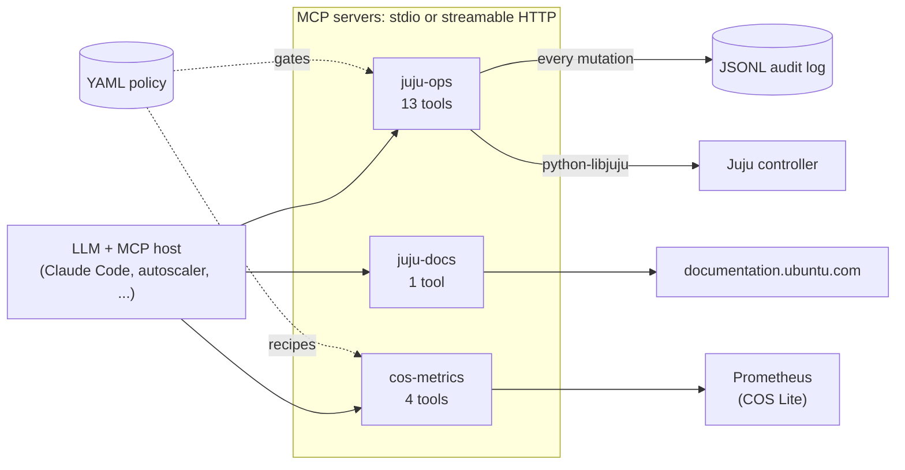

# juju-agent-mcps

[](https://github.com/Adithya-Rajendran/juju-agent-mcps/actions/workflows/ci.yml)

Three [Model Context Protocol](https://modelcontextprotocol.io) (MCP)
servers that let an LLM agent operate [Juju](https://juju.is) models,
with the guardrails enforced by the server rather than by the prompt:

- **`juju-ops`**: reads, diagnoses and changes a Juju model through
  [python-libjuju](https://github.com/juju/python-libjuju). Every
  mutation passes a YAML policy (per-app config allowlists, unit
  bounds, a forced-dry-run list) and lands in an audit log.
- **`juju-docs`**: searches the Juju documentation at
  [documentation.ubuntu.com/juju](https://documentation.ubuntu.com/juju/3.6/).
- **`cos-metrics`**: read-only Prometheus access for a
  [COS Lite](https://charmhub.io/cos-lite) stack. `get_scale_signal`
  turns operator-written PromQL recipes into a scale recommendation, so
  the model never writes PromQL.

## Highlights

- **Server-side guardrails.** A YAML policy enforces config allowlists,
  unit bounds and forced dry-runs no matter what the model passes, and
  every mutation (including refusals) is written to a JSONL audit log.
- **Real Juju API.** juju-ops drives the controller through
  python-libjuju, with no shelling out to the `juju` CLI.
- **Hermetic tests.** An in-process TLS fake Juju controller speaks
  enough of the Juju API for python-libjuju, so the whole suite runs
  without a cluster or network.
- **Evaluated on real models.** An eval harness for any OpenAI-compatible
  endpoint and four prompt suites, run against two open-weight models
  ([results](eval/FINDINGS.md)), plus tooling for an unattended loop
  that injects faults, grades the replies and has an agent propose
  fixes.
- **Closed-loop autoscaler.** A model reads Prometheus scale signals and
  scales a live postgresql cluster up and down within policy bounds.
- **CI** runs ruff and pytest on Python 3.11 and 3.12 with a coverage
  floor.

## Architecture



## Safety model

- **Policy lives on the server.** Bounds, allowlists and the
  forced-dry-run list are loaded from YAML at startup. The model never
  sees the policy file and can't talk its way past it; it only sees the
  structured refusal (e.g. *"config key 'foo' is not in the allowlist
  for 'postgresql' (allowed: [...])"*).
- **Mutations default to dry-run.** Every mutating tool except
  `juju_resolved` takes `dry_run`, which defaults to `true` and returns a
  plan. Tools listed in `mutations.force_dry_run` only ever return a
  plan, whatever the caller passes.
- **Hard bounds on scaling.** `juju_add_unit` can't go above an app's
  `max_units` and `juju_remove_unit` can't go below `min_units`. That
  is why the shipped policy can leave the scale tools out of
  `force_dry_run`.
- **Only declared apps and models.** `juju_resolved`,
  `juju_config_set`, `juju_add_unit` and `juju_remove_unit` refuse any
  application not declared in the policy. The provisioning tools
  (`juju_deploy`, `juju_add_model`, `juju_integrate`) create things the
  policy can't list in advance, so their safety net is `force_dry_run`,
  which covers all three in the shipped policy. Changes inside a model
  always target the policy's `default_model`. When `allowed_models` is
  set, read tools refuse any other model, and the server won't start if
  `default_model` isn't in the list.
- **No destructive verbs.** `juju run`, `juju ssh`, `juju exec`,
  `juju destroy-model` and `juju remove-application` are not tools at
  all, so refusing them doesn't depend on the model behaving.
- **Every mutation is audited.** Each mutating call writes exactly one
  JSON line (`{ts, tool, args, ok, reason}`), including refusals and
  failed Juju API calls. A failed API call comes back to the model as a
  refusal (`juju API error: ...`), not an exception.
- **Diagnosis is code.** `diagnose_unit` categorizes a unit in Python
  (`stuck_hook | blocked_config | machine_down | healthy | unknown`) and
  returns the evidence. The model reads the result; it doesn't produce
  the categorization.

## Quickstart

### Install

Python 3.11 or newer. Either:

```bash
# with uv (uses the committed uv.lock)
uv sync --locked --extra dev

# or with a plain venv
python3 -m venv .venv
.venv/bin/pip install -e '.[dev]'
```

This installs three console scripts: `juju-ops-mcp`, `juju-docs-mcp`
and `cos-metrics-mcp`.

### Run a server

Each server speaks MCP over stdio by default. Run them from the repo root
so the default policy paths resolve.

```bash
# juju-docs: no configuration needed
uv run juju-docs-mcp

# juju-ops: uses the current controller from your Juju CLI
# (~/.local/share/juju) unless JUJU_* variables say otherwise
uv run juju-ops-mcp

# cos-metrics: point it at your Prometheus
COS_PROM_URL=http://<cos-prometheus-host>/cos-prometheus-0 uv run cos-metrics-mcp
```

Before pointing juju-ops at a real controller, edit
`policy/juju-ops.yaml` so `default_model`, `allowed_models` and
`applications` describe your model.

To try a server by hand, use
[MCP Inspector](https://github.com/modelcontextprotocol/inspector):

```bash
npx @modelcontextprotocol/inspector uv run juju-docs-mcp
```

## Connecting to a host

### Over stdio (the host launches the server)

Most MCP hosts take a JSON server list. For example, in Claude Desktop's
`claude_desktop_config.json` or a project `.mcp.json` for Claude Code:

```json
{
  "mcpServers": {
    "juju-ops": {
      "command": "uv",
      "args": ["--directory", "/path/to/juju-agent-mcps", "run", "juju-ops-mcp"],
      "env": { "JUJU_OPS_POLICY": "/path/to/juju-agent-mcps/policy/juju-ops.yaml" }
    },
    "juju-docs": {
      "command": "uv",
      "args": ["--directory", "/path/to/juju-agent-mcps", "run", "juju-docs-mcp"]
    },
    "cos-metrics": {
      "command": "uv",
      "args": ["--directory", "/path/to/juju-agent-mcps", "run", "cos-metrics-mcp"],
      "env": { "COS_METRICS_POLICY": "/path/to/juju-agent-mcps/policy/cos-metrics.yaml" }
    }
  }
}
```

With Claude Code you can also add them from the command line, e.g.
`claude mcp add juju-docs -- uv --directory /path/to/juju-agent-mcps run juju-docs-mcp`.

### Over streamable HTTP (long-running services)

Each console script takes `--transport stdio|streamable-http` (default
`stdio`), `--host` (default `127.0.0.1`) and `--port` (default 8001 for
juju-docs, 8002 for juju-ops, 8003 for cos-metrics). With
`streamable-http`, MCP is served at `http://HOST:PORT/mcp`:

```bash
uv run juju-docs-mcp   --transport streamable-http --port 8001
uv run juju-ops-mcp    --transport streamable-http --port 8002
uv run cos-metrics-mcp --transport streamable-http --port 8003

# check all three: MCP handshake + tools/list, exit 1 if any is down
uv run python -m eval.auto.mcp_client
```

Point an HTTP-capable MCP host at those URLs (for Claude Code:
`claude mcp add --transport http juju-ops http://127.0.0.1:8002/mcp`).
For a long-lived install, [`deploy/systemd/`](deploy/systemd/) has user
units for all three servers, including where the juju-ops credentials go.
The autoscaler in `eval/auto/` uses these same HTTP endpoints.

> **Warning.** The HTTP transport has no authentication: anything that
> can reach the juju-ops port can drive your cluster within the policy
> bounds. The default `--host 127.0.0.1` keeps it on loopback, and on
> loopback the server also rejects requests whose `Host` header isn't
> local (DNS-rebinding protection). Passing a non-loopback `--host`
> turns that check off and prints a warning. Before exposing a port
> beyond localhost, put an authenticating reverse proxy in front.

## Configuration

### `policy/juju-ops.yaml`

Loaded once at startup (path from `JUJU_OPS_POLICY`, default
`policy/juju-ops.yaml` relative to the working directory).

| Key | Meaning |
|---|---|
| `schema_version` | Required; must be `1`. |
| `default_model` | Model used when a tool isn't given one. `JUJU_OPS_DEFAULT_MODEL` overrides it. |
| `allowed_models` | If non-empty, the only models any tool may touch. `default_model` must be in it. |
| `applications.<app>.config_allowlist` | Keys `juju_config_set` may change. |
| `applications.<app>.min_units` / `max_units` | Bounds for `juju_remove_unit` and `juju_add_unit`. |
| `mutations.force_dry_run` | Tools that only ever return a plan. |

Read-only tools work on any app in an allowed model. The shipped policy
forces dry-run for `juju_deploy`, `juju_add_model`, `juju_integrate` and
`juju_config_set`.

### `policy/cos-metrics.yaml`

Loaded once at startup (path from `COS_METRICS_POLICY`, default
`policy/cos-metrics.yaml`).

| Key | Meaning |
|---|---|
| `schema_version` | Required; must be `1`. |
| `prometheus.url` | Prometheus base URL. `COS_PROM_URL` overrides it. |
| `applications.<app>.breach_window` | How long a signal is evaluated over, as a Prometheus duration (`5m`, `1m30s`). Invalid values fail at load. |
| `applications.<app>.min_replicas` / `max_replicas` | Bounds on the recommendation. Keep them equal to `min_units` / `max_units` in `juju-ops.yaml`; a test checks the shipped files agree. |
| `applications.<app>.step_up` / `step_down` | Units added or removed per recommendation. |
| `applications.<app>.signals.<name>` | `promql`, `threshold_high`, `threshold_low`. |

A signal above `threshold_high` for at least half the breach window
recommends scaling up. Scaling down needs every signal that evaluated to
be below `threshold_low`; signals whose query fails are skipped and
counted in `signals_failed`.

### Environment variables

[`.env.example`](.env.example) is a commented template. Nothing loads it
automatically: `source` it, or copy it to `~/.config/juju-ops-mcp.env`
for the systemd unit.

| Variable | Default | Used by |
|---|---|---|
| `JUJU_CONTROLLER_ENDPOINT` | unset | juju-ops. `host:port` of the controller API. When set, the local Juju CLI files are not used. |
| `JUJU_USERNAME` | unset | juju-ops, with `JUJU_CONTROLLER_ENDPOINT`. |
| `JUJU_PASSWORD` | unset | juju-ops, with `JUJU_CONTROLLER_ENDPOINT`. |
| `JUJU_CACERT` | unset | juju-ops, with `JUJU_CONTROLLER_ENDPOINT`. Controller CA as a PEM literal or a path to a PEM file. |
| `JUJU_CONTROLLER` | current controller | juju-ops. A named controller from the local Juju CLI files; bare model names become `<controller>:<model>`. Ignored when `JUJU_CONTROLLER_ENDPOINT` is set. |
| `JUJU_OPS_POLICY` | `policy/juju-ops.yaml` | juju-ops; also read by the autoscaler (postgresql min/max units) and the auto-eval grader (the `force_dry_run` list reported in grade.json). |
| `JUJU_OPS_DEFAULT_MODEL` | policy `default_model` | juju-ops. Must be in `allowed_models` when that is non-empty. |
| `JUJU_OPS_AUDIT_LOG` | stderr | juju-ops. JSONL file the audit records are appended to. |
| `JUJU_OPS_AUDIT` | `on` | juju-ops. `off` disables the audit log. |
| `JUJU_DOCS_BASE` | `https://documentation.ubuntu.com` | juju-docs |
| `JUJU_DOCS_PROJECT` | `canonical-juju` | juju-docs. Read the Docs project slug. |
| `JUJU_DOCS_VERSION` | `3.6` | juju-docs. Docs version to search. |
| `JUJU_DOCS_HTTP_TIMEOUT_S` | `10` | juju-docs |
| `COS_METRICS_POLICY` | `policy/cos-metrics.yaml` | cos-metrics |
| `COS_PROM_URL` | policy `prometheus.url` | cos-metrics. Overrides the policy's Prometheus URL. |
| `COS_METRICS_TIMEOUT_S` | `30` | cos-metrics. Prometheus HTTP timeout. |
| `EVAL_BASE_URL` | unset (required) | eval. Base URL of an OpenAI-compatible chat API, including the version prefix (e.g. `http://127.0.0.1:11434/v1`); the harness POSTs to `$EVAL_BASE_URL/chat/completions`. |
| `EVAL_API_KEY` | unset | eval. Bearer token, only if the endpoint needs one; when unset no `Authorization` header is sent. |
| `EVAL_MODEL` | `qwen3.6:35b` | eval. Model name at the endpoint. |
| `EVAL_MODELS` | `gemma4:31b qwen3.6:35b` | `eval/auto/auto-eval.sh`. Space-separated models one sweep runs. |
| `EVAL_MAX_ROUNDS` | `8` | eval. Tool-call rounds per prompt. |
| `EVAL_HTTP_TIMEOUT_S` | `120` | eval |
| `EVAL_TEMPERATURE` | `0.3` | eval. Empty string uses the model's default. |
| `EVAL_SYSTEM_PROMPT_FILE` | `eval/system_prompt.md` | eval |

The autoscaler and auto-eval scripts take a few more (tick counts, load
settings); see [`eval/auto/RUNNING.md`](eval/auto/RUNNING.md) and
[`eval/auto/README.md`](eval/auto/README.md).

## Tools

18 tools in total: 13 in juju-ops, 1 in juju-docs and 4 in cos-metrics.
Every result has `ok`. A refusal is `{ok: false, reason}`, sometimes with
extra context such as `current`; a controller or connection failure in a
juju-ops tool comes back the same way, with a reason starting
`juju API error:`.

### juju-ops

| Tier | Tool | Notes |
|---|---|---|
| 1 read | `juju_status` | Full status for a model. Large. |
| 1 read | `juju_show_unit` | One unit. |
| 1 read | `juju_show_application` | One application. |
| 1 read | `juju_machines` | Machines in a model. |
| 1 read | `juju_debug_log` | Most recent `lines` entries at or above `level` (TRACE, DEBUG, INFO, WARNING, ERROR). |
| 2 diagnose | `diagnose_unit` | `{category, evidence, suggested_action}` in one call; `evidence.recent_log` is the unit's last 20 log lines. |
| 3 mutate | `juju_resolved` | Clear a unit's error state. No `dry_run` argument; runs unless listed in `force_dry_run`. |
| 3 mutate | `juju_config_set` | One key, which must be in the app's `config_allowlist`. Forced dry-run in the shipped policy. |
| 4 scale | `juju_add_unit` | Add `count` units; bounded by `max_units`. |
| 4 provision | `juju_deploy` | Deploy a single Charmhub charm. Refuses an existing app name, bundles, and a `trust` key in `config`. Forced dry-run in the shipped policy. |
| 4 provision | `juju_add_model` | Create a model. Refuses an existing one. Forced dry-run in the shipped policy. |
| 4 provision | `juju_integrate` | Relate two existing apps. Forced dry-run in the shipped policy. |
| 5 scale down | `juju_remove_unit` | Remove one unit; bounded by `min_units`. Call once per unit. |

A mutating tool returns
`{ok, tool, dry_run, dry_run_forced_by_policy, plan, result}`, where
`result` is `"executed"` after a real run and otherwise a dry-run note.
Validation, policy gates and existence checks all run before the dry-run
decision, so a plan is only returned for a call that would have run.

### juju-docs

`search_juju_docs(query, category=None, max_results=5)` returns
`{ok: true, results: [{title, url, excerpt, category, juju_version_hint}]}`.
`category` is the Diataxis section (`tutorial`, `howto`, `reference`,
`explanation`). If the search backend is unreachable or returns an error,
the result is `{ok: false, reason}` rather than an empty list, so the
model reports an outage instead of rephrasing.

### cos-metrics

| Tool | Notes |
|---|---|
| `get_scale_signal(app)` | `{current_replicas, recommended_replicas, delta, reason, signals_evaluated, signals_failed}` from the policy recipes. Act on it with `juju_add_unit(count=delta)` or one `juju_remove_unit` per unit. |
| `cos_active_alerts(severity=None)` | Active alerts, pending or firing; check each alert's `state`. |
| `prom_query(query)` | Instant PromQL query (escape hatch). |
| `prom_query_range(query, start, end, step="15s")` | Range query; `start`/`end` are Unix timestamps or RFC 3339. |

## Evaluation

The [`eval/`](eval/) directory tests how well a model drives these tools.

- **Harness.** [`eval/harness.py`](eval/harness.py) sends each prompt to
  any OpenAI-compatible chat API (vLLM, Ollama, llama.cpp server, a
  hosted provider) with the tools' specs, runs the model's tool calls
  in-process through the same validation and policy gate as the MCP
  servers, and writes a JSON transcript per prompt. The investigative
  doctrine in [`eval/system_prompt.md`](eval/system_prompt.md) is sent
  as the system prompt unless you pass `--no-system-prompt`.

  ```bash
  EVAL_BASE_URL=http://127.0.0.1:11434/v1 EVAL_MODEL=qwen3.6:35b \
    uv run python -m eval.harness eval/prompts.yaml \
      [--only=diag_overall,diag_blocked_config] \
      [--categories=diagnosis,mutation] \
      [--include-skipped] [--out-dir=eval/runs/my-run]
  ```

  juju-ops talks to whatever controller your `JUJU_*` variables (or
  Juju CLI) point at, so run it against a disposable model. The summary
  prints `expected=ok|MISS` for prompts that name an expected tool.
- **Prompt sets.** [`prompts.yaml`](eval/prompts.yaml) (26 general
  prompts: diagnosis, docs, scale signals, mutations, deploys, traps),
  [`scenarios-lifecycle.yaml`](eval/scenarios-lifecycle.yaml) (28),
  [`scenarios-investigate.yaml`](eval/scenarios-investigate.yaml) (11)
  and [`scenarios-cos.yaml`](eval/scenarios-cos.yaml) (16).
- **Auto-eval loop.** Built to run from a 6-hourly systemd timer: each
  sweep injects one fault from
  [`eval/auto/fault-library.yaml`](eval/auto/fault-library.yaml) into a
  live test model, runs that fault's prompts against each configured
  model, grades the replies with [`eval/auto/helper.py`](eval/auto/helper.py)
  and commits the results, and a separate scheduled agent reads them and
  opens improvement PRs. No sweep results are published yet. See
  [`eval/auto/README.md`](eval/auto/README.md).
- **Autoscaler.** [`eval/auto/autoscaler.py`](eval/auto/autoscaler.py)
  runs a tick loop (default every 2 minutes). Each tick asks the model,
  in a fresh conversation, to read `get_scale_signal("postgresql")` and
  either hold or make one `juju_add_unit` / `juju_remove_unit` call with
  `dry_run=false`. Tool calls go through the running MCP servers over
  streamable HTTP, so they pass the same policy gate and audit log as
  any other client. [`RUNNING.md`](eval/auto/RUNNING.md) covers the
  60-minute session and the 15-minute demo;
  [`ARCHITECTURE.md`](eval/auto/ARCHITECTURE.md) shows how a tick flows.

### Evaluation results

Live runs used `gemma4:31b` and `qwen3.6:35b` against a Juju 3.6
controller in a private OpenStack lab. Full write-up:
[`eval/FINDINGS.md`](eval/FINDINGS.md).

- On the 28-prompt lifecycle suite, qwen3.6:35b finished 26 prompts
  with a final reply and gemma4:31b 21 (all seven of gemma's errors were
  proxy timeouts); qwen was about 2.5x faster end to end. Finishing is
  not the same as being right; the write-up covers what each model did.
- Both models set `dry_run=False` without being asked. Once, before
  `juju_add_unit` was on the forced-dry-run list, that really added a
  unit. Later, gemma turned "whatever's wrong, fix it" into a
  `juju_remove_unit` and qwen tried to delete an application one
  `juju_remove_unit` at a time; the `force_dry_run` list in force then
  blocked both. That is why the limits are enforced by the server rather
  than the prompt. The shipped policy now bounds the scale tools with
  `min_units`/`max_units` instead, so the autoscaler can use them.
- Tools named after the user's verb were picked first time; requests
  with no plausible tool path (SSH, destroy the controller) were refused
  without a tool call; refusals that list the allowed values produced
  the most useful replies.
- The autoscaler took a 3-unit postgresql cluster under `pgbench` load
  to the policy maximum of 7 and back to 3 within an hour, with no
  out-of-bounds request.
- A doctrine-prompt A/B was inconclusive: it added a read-before-mutate
  step but regressed one prompt, so it is not relied on for safety.

## Development

```bash
uv sync --locked --extra dev
uv run pytest            # no controller or network needed; reports coverage
uv run ruff check .
```

- **Fake controller.** [`tests/fake_juju/`](tests/fake_juju/) is an
  in-process TLS WebSocket server that speaks enough of the Juju API for
  python-libjuju. Tests that need it request the `juju_ops_env` fixture
  from [`tests/conftest.py`](tests/conftest.py), which starts it, points
  the `JUJU_*` variables at it and loads
  [`tests/policy/juju-ops.test.yaml`](tests/policy/juju-ops.test.yaml).
  There is no test-only code path inside `juju_ops`.
- **CI** runs ruff and pytest on Python 3.11 and 3.12 for pushes to
  `main` and pull requests, with a 75% coverage floor set in
  [`.github/workflows/ci.yml`](.github/workflows/ci.yml).
- **Dependencies** are locked in `uv.lock`. After changing
  `pyproject.toml`, run `uv lock` and commit the lock file. Dependabot
  updates it weekly.

## Repo layout

```
juju-agent-mcps/
├── juju_ops/                  # juju-ops MCP server (13 tools)
│   ├── server.py              # FastMCP app and tool descriptions
│   ├── tools/                 # readonly.py, mutate.py: tool implementations
│   ├── juju_client.py         # python-libjuju controller/model connections
│   ├── _dispatch.py           # validate → policy gate → execute → audit
│   └── policy.py, validation.py, audit.py, _results.py, _responses.py
├── juju_docs/server.py        # juju-docs MCP server (Read the Docs search)
├── cos_metrics/               # cos-metrics MCP server: server.py, tools.py, policy.py
├── policy/                    # juju-ops.yaml, cos-metrics.yaml, cos-metrics-demo.yaml
├── deploy/systemd/            # user units serving MCP over streamable HTTP
├── eval/
│   ├── FINDINGS.md            # evaluation results
│   ├── harness.py, tool_specs.py
│   ├── system_prompt.md       # investigative-flow doctrine
│   ├── prompts.yaml, scenarios-*.yaml
│   └── auto/                  # autoscaler, auto-eval loop, grader, runbooks
├── tests/
│   ├── fake_juju/             # in-process TLS fake Juju controller
│   └── conftest.py, policy/, test_*.py
├── .github/                   # CI workflow, Dependabot
├── .env.example, pyproject.toml, uv.lock
└── SECURITY.md, LICENSE
```

## History

Started in May 2026 as a proof of concept: can a mid-sized open-weight
model operate Juju safely if the guardrails live in the tool servers?
The first version used canned fixtures and the `juju` CLI. It then moved
to a live Juju 3.6 lab with COS Lite, gained cos-metrics, a two-model
comparison, the autoscaler and tooling for an auto-eval loop, and was later
reworked onto python-libjuju with a fake controller for tests.

## License

Apache 2.0. See [`LICENSE`](LICENSE).
